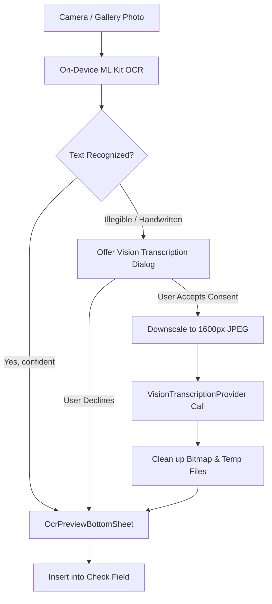

# Vision-Model Handwriting Transcription Architecture

> **Status**: Architectural Specification (Document Only — Implementation on Hold per Project Guidelines).
> **Objective**: Provide high-accuracy transcription for handwritten German text (e.g. hand-written essays, homework, B2 exam practice sheets) via multimodal vision LLMs when on-device OCR is insufficient.

---

## 1. Architectural Principles

1. **User Privacy & Explicit Per-Request Consent**:
   - On-device OCR (ML Kit) remains the default, 100% offline path for printed text with zero cloud transmission.
   - Vision-model transcription sends image bytes to a third-party cloud provider (e.g. Gemini 2.5 Flash / Pro, Claude 3.5 Sonnet, GPT-4o).
   - **Mandatory Consent**: Every single vision request requires an explicit confirmation dialog displaying the active provider and a clear notice that image data is transmitted for transcription only.

2. **Zero Permanent Storage**:
   - Images are processed strictly in memory or temporary files.
   - Downscaled bitmap is converted to base64, sent via HTTPS, and immediately garbage-collected.
   - Temporary cache files are deleted immediately in `finally` blocks.

3. **Client-Side Image Optimization**:
   - Large device camera photos (e.g. 12–50 MP, 10–25 MB) must be downscaled client-side before transmission:
     - Max dimension constraint: Long edge scaled down to $\le 1600$ pixels.
     - Format: JPEG with quality 85%.
     - Target payload size: $< 500$ KB per page.
     - EXIF orientation applied before cropping/encoding to ensure correct text reading direction.

---

## 2. Provider Capability Interface

To cleanly integrate with the existing BYOK provider architecture (`TranslationProvider`, `StructuredGenerationProvider`):

```kotlin
interface VisionTranscriptionProvider {
    /**
     * Whether the active model supports multimodal image input.
     */
    val supportsVision: Boolean

    /**
     * Transcribes text from an image bitmap.
     * @param imageBytes JPEG bytes (downscaled).
     * @param mimeType "image/jpeg"
     * @param prompt Instructions for transcription.
     */
    suspend fun transcribeImage(
        imageBytes: ByteArray,
        mimeType: String = "image/jpeg",
        prompt: String
    ): Result<String>
}
```

### Supported Provider Implementations:
- **GeminiProvider**: Native `inlineData` with base64 encoded bytes in `generateContent` API.
- **OpenAiCompatibleProvider** (Groq, OpenRouter, Mistral, Cerebras): `image_url` with data URI (`data:image/jpeg;base64,...`) in `user` message `content` array for vision-capable models (e.g. `meta-llama/llama-3.2-11b-vision-instruct`, `google/gemini-2.0-flash`, `gpt-4o`).

---

## 3. Strict Verbatim Transcription Prompt

The system prompt enforces exact verbatim transcription without corrections or additions:

```text
You are a precise German palaeographer and transcription assistant.
Your task is to transcribe the handwritten German text from the image verbatim.

RULES:
1. Output ONLY the transcribed German text. Do NOT add preamble, commentary, or markdown formatting.
2. Preserve original spelling, capitalization (Gross-/Kleinschreibung), punctuation, paragraphs, and line breaks exactly as written by the author.
3. Do NOT fix grammatical, lexical, or orthographic errors — transcribe them exactly as written.
4. For words or characters that are genuinely unreadable or illegible, insert "[?]" in their place.
5. Do NOT invent or guess missing words.
6. German letters (ä, ö, ü, Ä, Ö, Ü, ß) must be transcribed faithfully.
```

---

## 4. UI Flow & Preview Integration



---

## 5. Security & Cost Guardrails

1. **Per-request Confirmation**: Prevents accidental quota exhaustion or unwanted cloud transmission.
2. **Rate Limiting**: Integrated with existing `RetryAfterInterceptor` and client-side throttle.
3. **Payload Sanitization**: Strips all EXIF metadata (GPS location, device serial, timestamp) during downscaling before base64 transmission.
